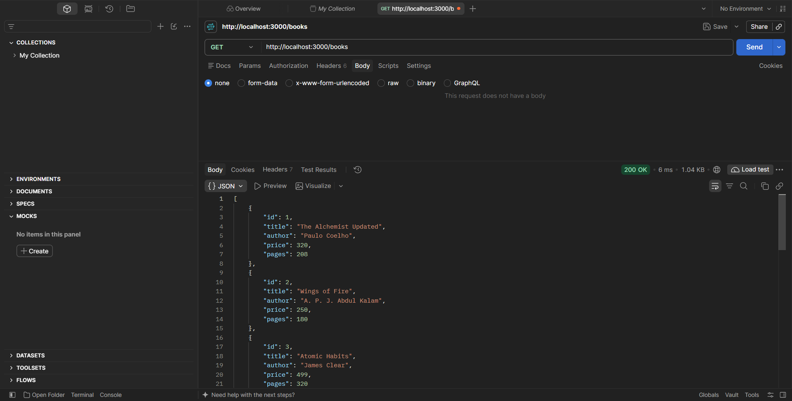
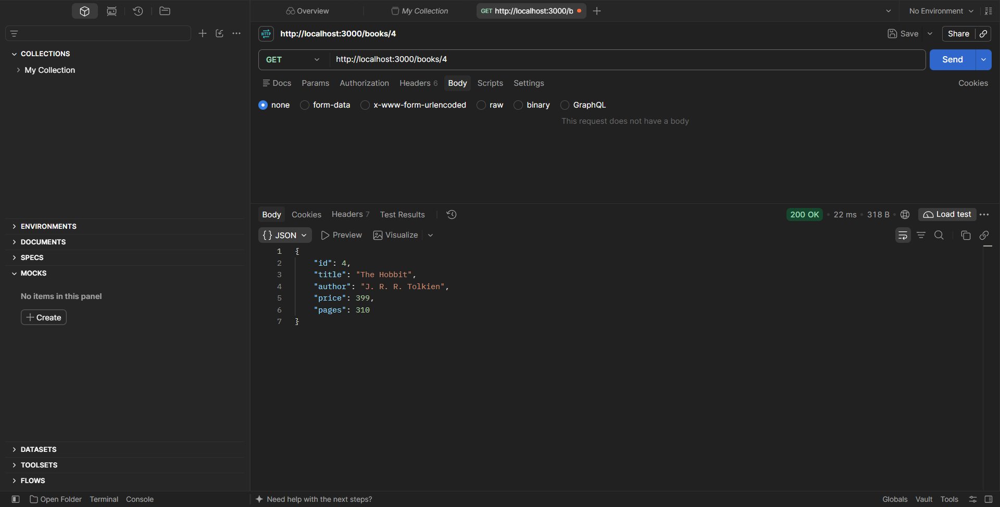
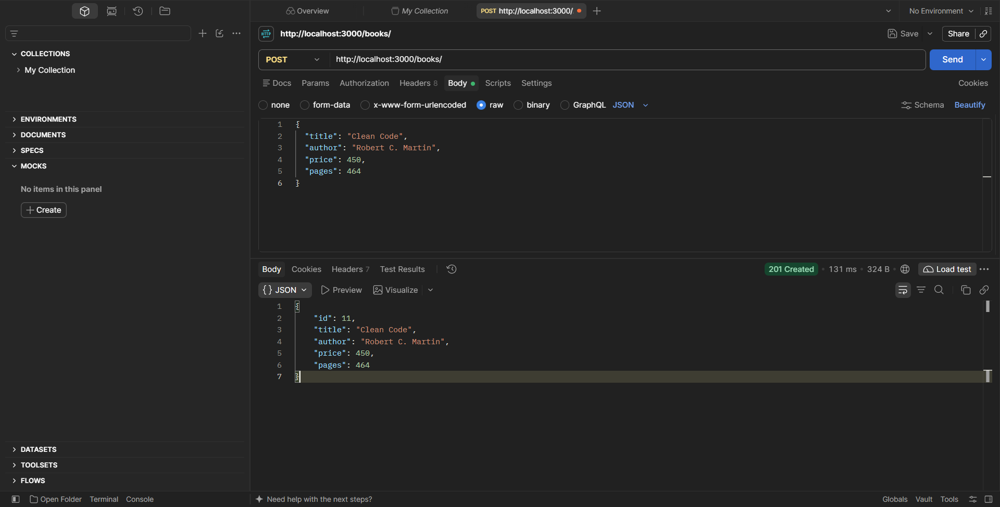
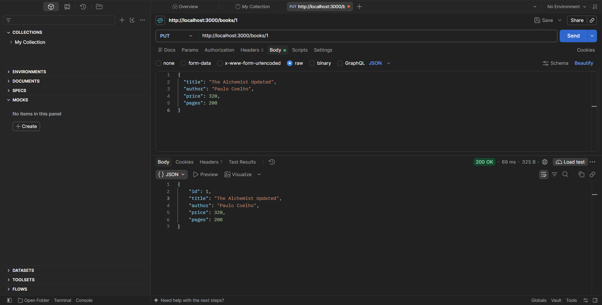
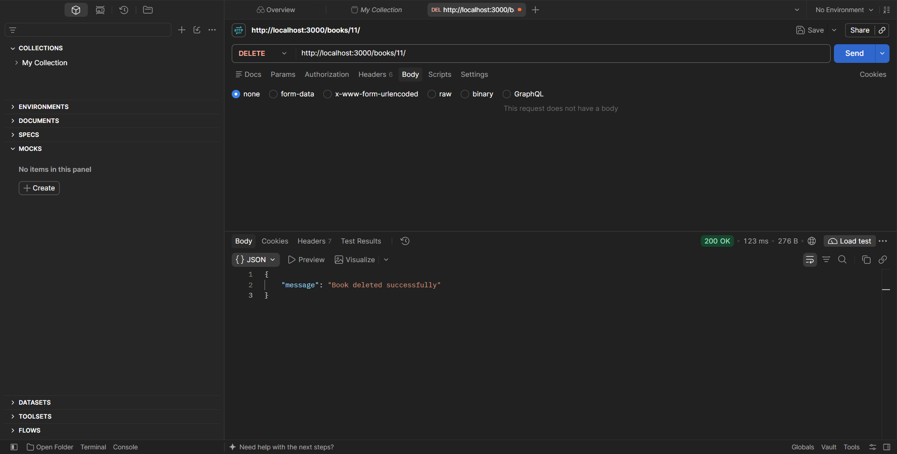
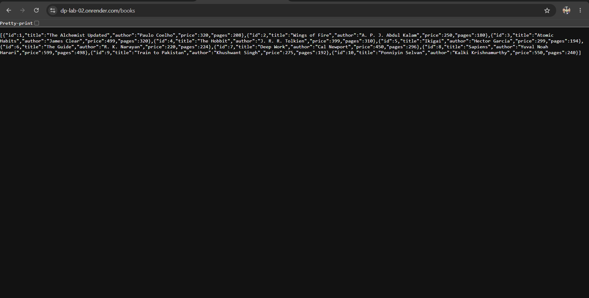

# Lab 2: SQLite database and CRUD routes

**Name:** G Harshith Reddy   
**Registration number:** 252U1R6078
**Section:** AIML-2B / 207

**Live link:** https://dp-lab-02.onrender.com

## Description
An Express application connected to a SQLite database. It provides five CRUD endpoints for books.

## Requirements
- Node.js and npm
- Optional: SQLite command-line tool for running `database/books.sql`
- Postman for endpoint testing

## Install and run
```bash
npm install
npm run dev
```
The server runs on `http://localhost:3000`. Use `npm start` for normal start without automatic restart.

## Database
The included `books.db` contains the `book` table and 10 sample rows. The SQL used to create and seed the table is in `database/books.sql`.

To create/check the database using SQLite CLI:
```bash
sqlite3 books.db
```
Then run the SQL statements from `database/books.sql` (or from the SQLite prompt use `.read database/books.sql`).

Useful SQLite commands:
```sql
.tables
.schema book
SELECT * FROM book;
.quit
```

## Endpoints

| Method | Path | Description |
|---|---|---|
| GET | `/books/` | Get all books |
| GET | `/books/:bookId/` | Get one book by ID |
| POST | `/books/` | Add a new book |
| PUT | `/books/:bookId/` | Replace the details of a book |
| DELETE | `/books/:bookId/` | Delete a book |

### POST and PUT JSON body
```json
{
  "title": "Clean Code",
  "author": "Robert C. Martin",
  "price": 450,
  "pages": 464
}
```

## Screenshots

### GET /books/ - all books (200)


### GET /books/4 - one book (200)


### POST /books/ - add a book (201)


### PUT /books/1 - update a book (200)


### DELETE /books/11/ - delete a book (200)


### Live deployment - GET /books

```

## Notes
- User-provided values are passed through `?` placeholders.
- `node_modules/` and `.env` are excluded by `.gitignore`.
- The database file `books.db` is included because the lab asks you to submit the `.db` file.
