# Lab 3: REST API, query parameters, validation, debugging

**Name:** G Harshith Reddy 
**Registration number:** 252U1R6078
**Section:** AIML-2B / 207

**Live link:** https://dp-lab-03.onrender.com/

## Objective
Turn the Lab 2 book routes into a REST API with search, sorting, price filtering, pagination, validation, correct status codes and debugging practice.

## Requirements
- Node.js and npm
- SQLite database
- Postman

## Install and run
```powershell
npm install
npm run dev
```
For normal start:
```powershell
npm start
```
The server runs on `http://localhost:3000`.

## Environment variables
- `PORT` — server port. Local default: 3000.
- `DB_PATH` — optional full path to the SQLite database file. Local default: `books.db` in this folder.

No real secrets are used in this project. `.env` is not committed.

## Database
`books.db` contains the `book` table (`id`, `title`, `author`, `price`, `pages`). The SQL that creates the table and inserts 61 sample books is in `database/books.sql`.

## Endpoints

| Method | Path | Description |
|---|---|---|
| GET | `/` | API health check |
| GET | `/books` | List books with search, sort, price filters and pagination |
| GET | `/books/:bookId` | Get one book |
| POST | `/books` | Create a book |
| PUT | `/books/:bookId` | Update a book |
| DELETE | `/books/:bookId` | Delete a book |

### GET /books query parameters
- `search_q` — partial title search; no search filter if omitted.
- `order_by` — one of `id`, `title`, `author`, `price`, `pages`; default `id`.
- `order` — `ASC` or `DESC`; default `ASC`.
- `limit` — integer 1–100; default `100`.
- `offset` — non-negative integer; default `0`.
- `min_price` — optional non-negative number.
- `max_price` — optional non-negative number.

Example:
`/books?search_q=atomic&order_by=price&order=DESC&limit=5&offset=0&min_price=100&max_price=500`

### POST and PUT JSON body
```json
{
  "title": "Test Book",
  "author": "Test Author",
  "price": 250,
  "pages": 150
}
```

### Status codes used
| Status | When |
|---|---|
| 200 | Successful GET, PUT or DELETE |
| 201 | Book created with POST |
| 400 | Invalid query parameter, invalid id, or invalid request body |
| 404 | Book not found, or unknown route |
| 500 | Unexpected database error |

## Tests performed (Postman, SQLite and browser)

| # | Request | Result | Screenshot |
|---|---|---|---|
| 1 | GET `/books` | 200, all books | `01-get-all-books.png` |
| 2 | GET `/books/?search_q=rich` | 200, titles containing "rich" | `02-search-by-title.png` |
| 3 | GET `/books/?order_by=price&order=ASC` | 200, lowest price first | `03-sort-price-asc.png` |
| 4 | GET `/books/?order_by=price&order=DESC` | 200, highest price first | `04-sort-price-desc.png` |
| 5 | GET `/books/?limit=5&offset=0` | 200, first 5 books | `05-pagination-page-1.png` |
| 6 | GET `/books/?limit=5&offset=5` | 200, next 5 books | `06-pagination-page-2.png` |
| 7 | GET `/books/?min_price=200&max_price=400` | 200, prices from 200 to 400 | `07-price-range-filter.png` |
| 8 | GET `/books/5` | 200, one book | `08-get-one-book.png` |
| 9 | GET `/books/9999/` | 404, Book not found | `09-get-book-not-found-404.png` |
| 10 | POST `/books/` with valid JSON | 201, new book with id 62 | `10-post-success-201.png` |
| 11 | POST `/books/` with no title, price -100, pages 0 | 400, validation error | `11-post-validation-error-400.png` |
| 12 | PUT `/books/1` with valid JSON | 200, updated book | `12-put-success-200.png` |
| 13 | DELETE `/books/1` | 200, Book deleted successfully | `13-delete-success-200.png` |
| 14 | `SELECT COUNT(*) FROM book;` in SQLite | 61 rows | `14-database-row-count.png` |
| 15 | GET `/` in the browser | Server is running successfully! | `15-health-check.png` |

## Screenshots

### 1. GET /books - all books (200)
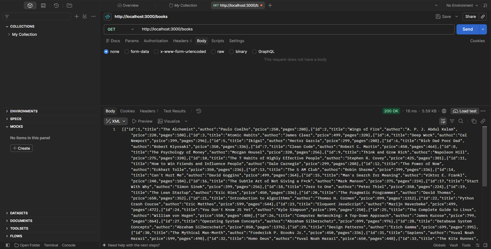

### 2. Search by title - search_q=rich (200)
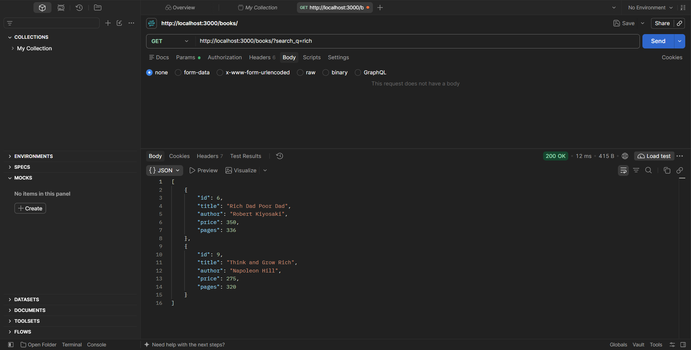

### 3. Sort by price ascending (200)
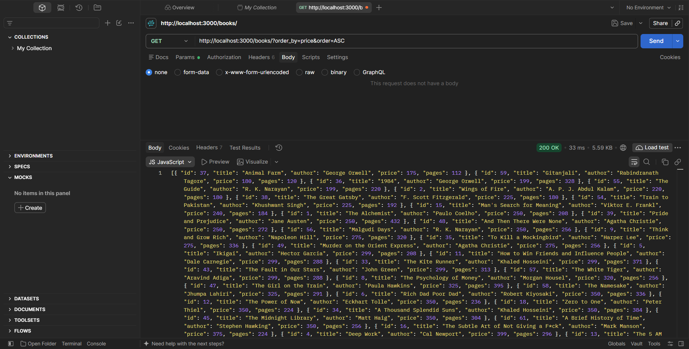

### 4. Sort by price descending (200)
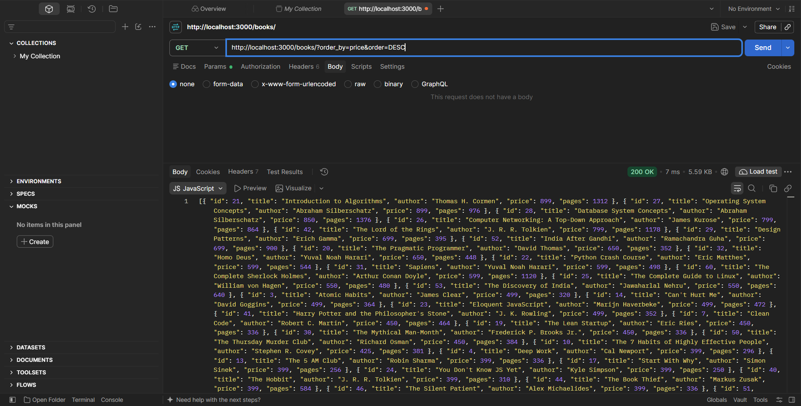

### 5. Pagination - limit=5, offset=0 (200)
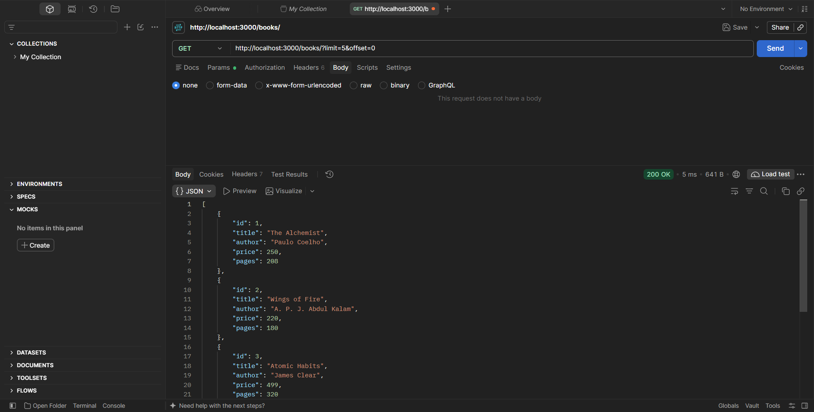

### 6. Pagination - limit=5, offset=5 (200)
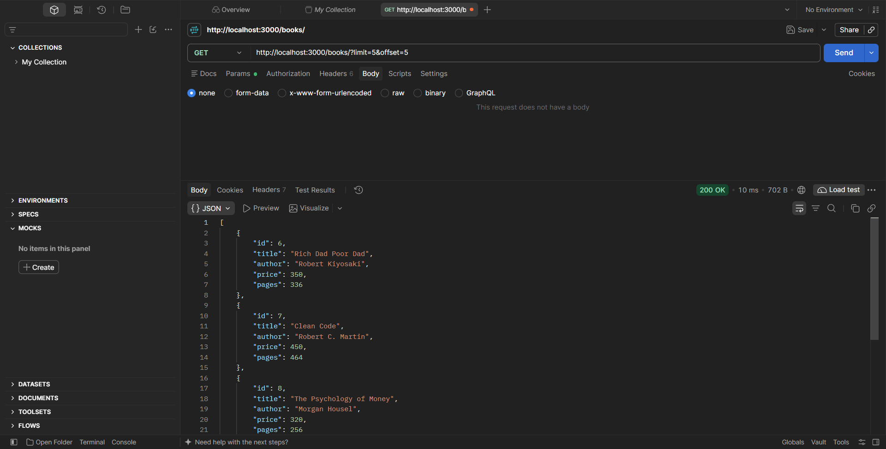

### 7. Price range filter - min_price=200, max_price=400 (200)
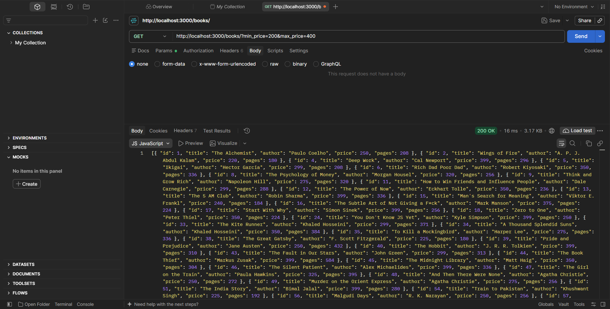

### 8. GET /books/5 - one book (200)
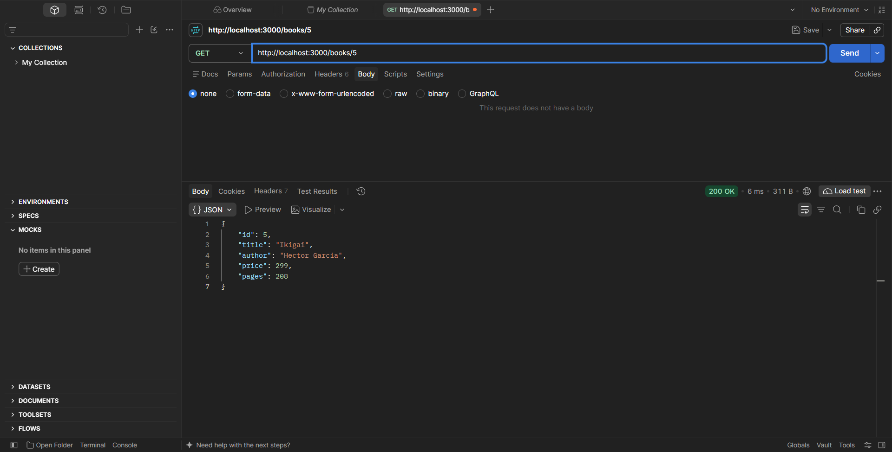

### 9. GET /books/9999/ - book not found (404)


### 10. POST /books/ - create a book (201)
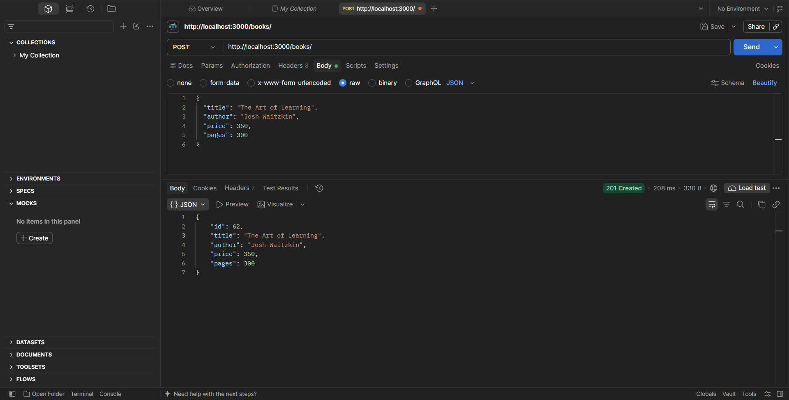

### 11. POST /books/ - validation error (400)
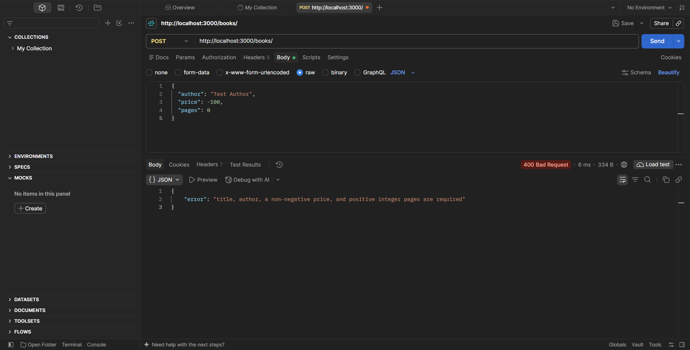

### 12. PUT /books/1 - update a book (200)
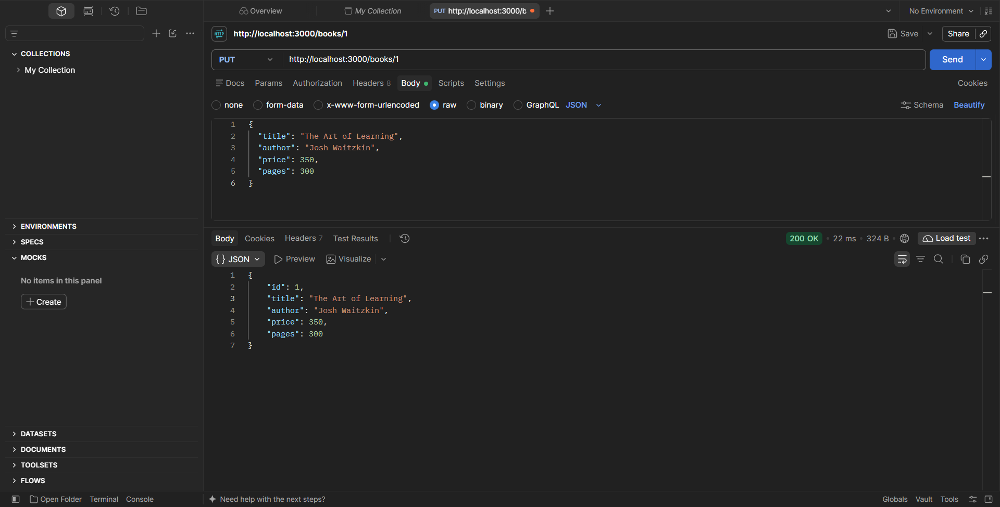

### 13. DELETE /books/1 - delete a book (200)
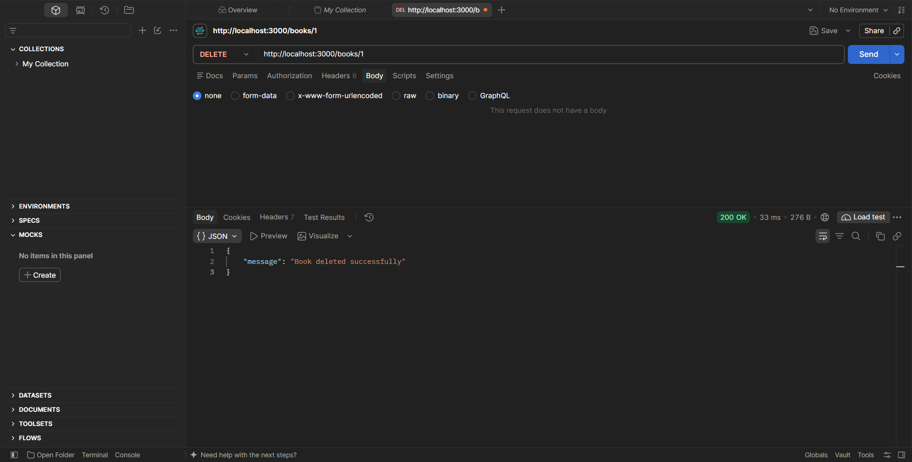

### 14. SQLite - row count


### 15. GET / - health check


The status in this screenshot is 304 Not Modified because the browser reused its cached copy of the page; the first request to `/` returns 200.

## Notes
- All values from the user go into SQL through `?` placeholders. Search text, price limits, `limit` and `offset` are never joined into the query string.
- A column name cannot be a `?` placeholder, so `order_by` is checked against a fixed list of allowed columns (`id`, `title`, `author`, `price`, `pages`) before it is used in `ORDER BY`. `order` must be `ASC` or `DESC`.
- `limit` must be an integer from 1 to 100 and `offset` must be a non-negative integer, otherwise the API returns 400.
- `bookId` must be a positive integer, otherwise the API returns 400. A valid id that does not exist returns 404.
- POST and PUT check that `title` and `author` are non-empty text, `price` is a non-negative number and `pages` is a positive integer.
- Every route returns JSON with the right status code, and database errors are caught and returned as 500.
